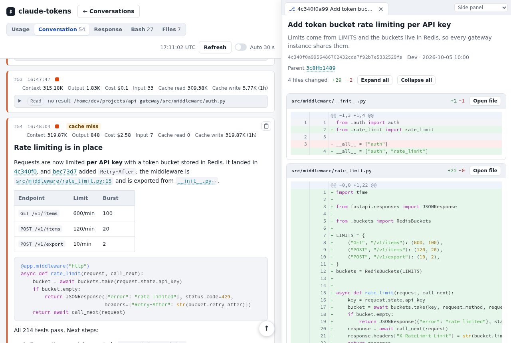
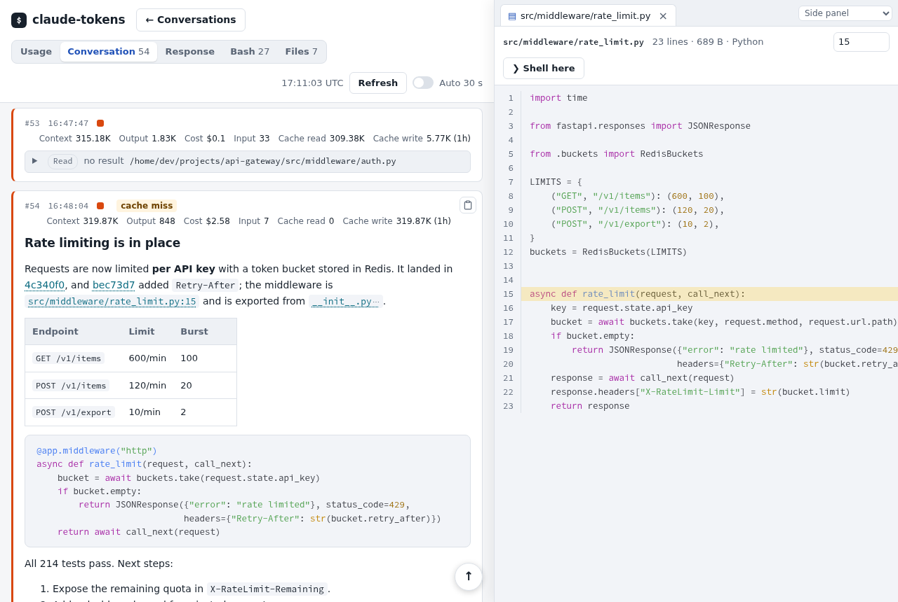
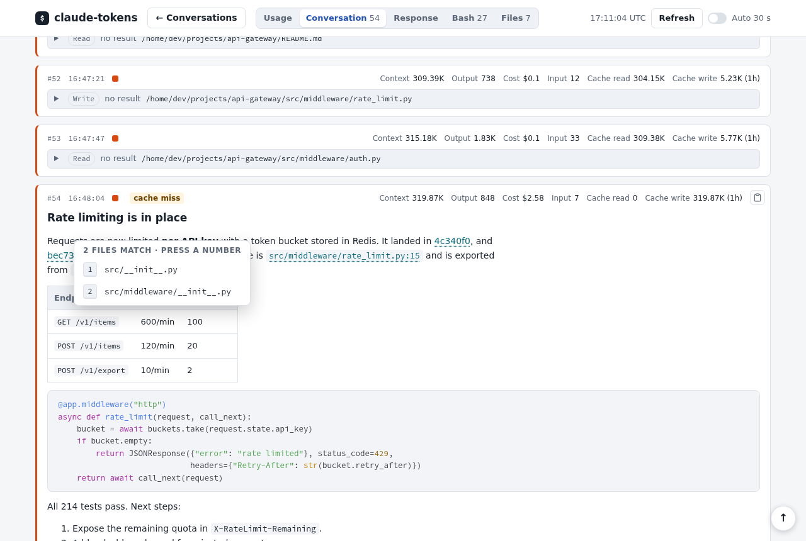
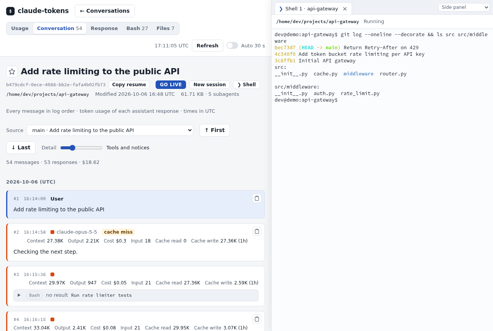
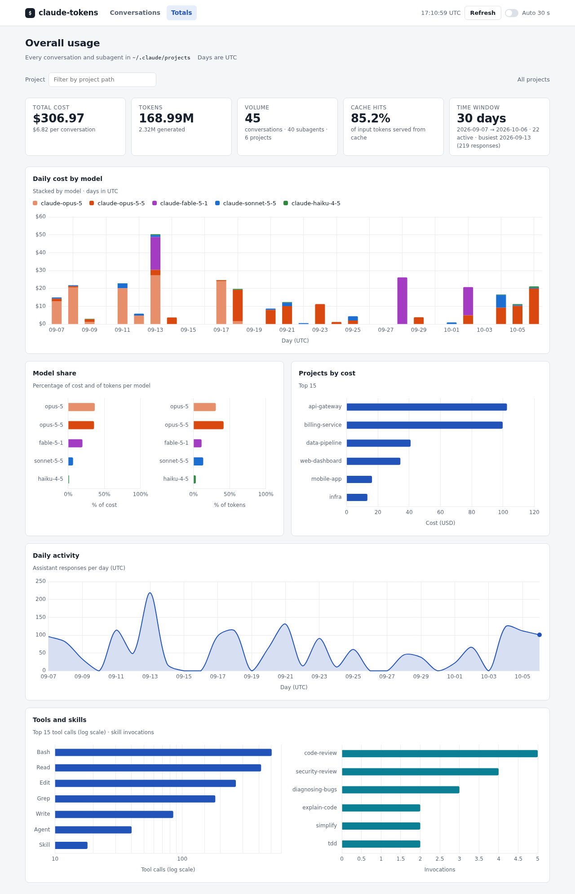
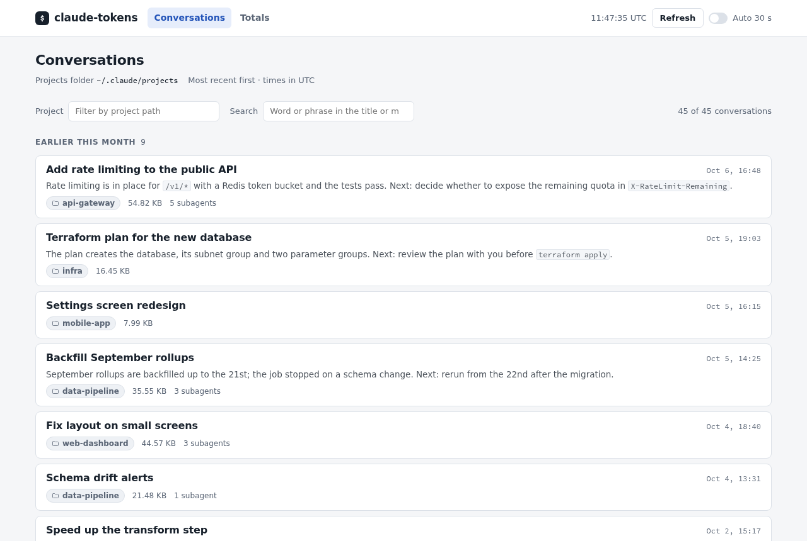
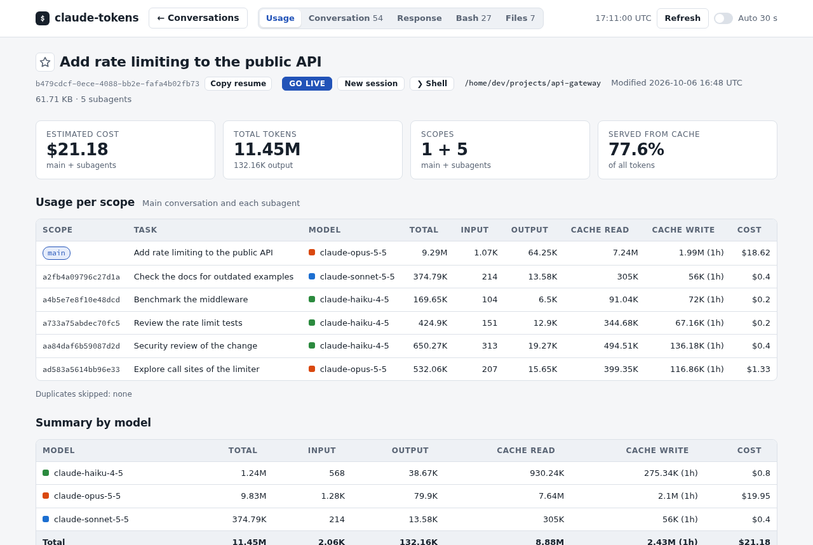
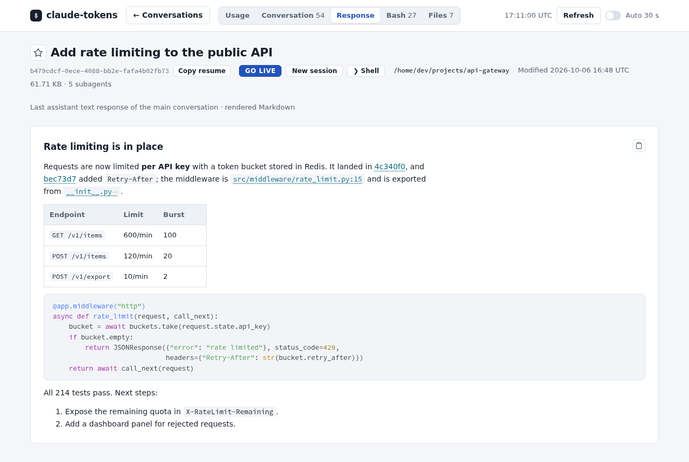
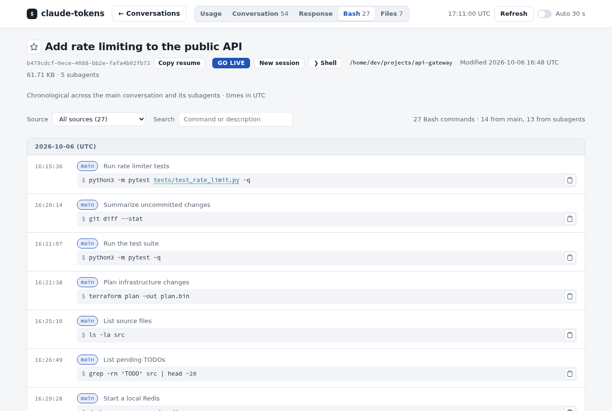
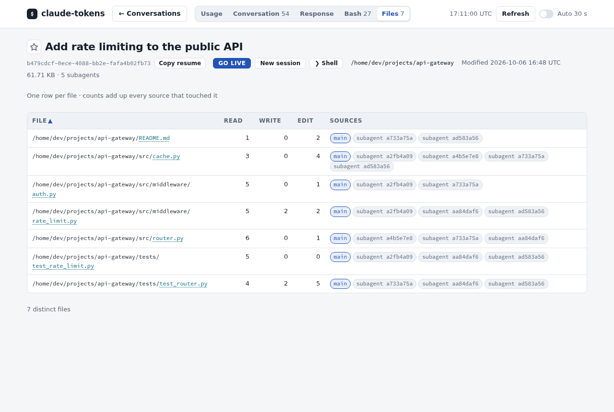

# claude-tokens

Dependency-free utility that summarizes tokens and estimated cost from a Claude
Code JSONL conversation and its subagent logs: `<session>/subagents/agent-*.jsonl`
and, for workflow agents, `<session>/subagents/workflows/<run>/agent-*.jsonl`.

```bash
python3 claude_tokens.py /path/to/conversation.jsonl
python3 claude_tokens.py /path/to/conversation.jsonl --json
python3 claude_tokens.py d91dbfb9-4ca2-495a-aa23-938757a38997   # by conversation id
```

Instead of a path you can pass a bare **conversation id** (the JSONL filename
without extension); it is located automatically under the projects folder.

If you omit the conversation, it browses the Claude projects folder
(`~/.claude/projects`, or `$CLAUDE_CONFIG_DIR/projects`) and shows an
interactive picker with the most recent conversations first: the session GUID
(the JSONL filename, i.e. the session id), size on disk (the log plus its
session folder: subagent logs and saved tool results), number of subagents used,
project path, and the session title (its rename/`aiTitle`, blank when the
session was never named). The list is paged 10 at a time: type a
number to analyze that conversation, press Enter for the next 10, `a` to show
them all, or `q` to quit. Filter by project with `--project`:

```bash
python3 claude_tokens.py                       # pick from all projects
python3 claude_tokens.py --project webfilter   # only matching project paths
python3 claude_tokens.py --projects-dir /other/projects
```

The picker looks like this (data below is illustrative):

```
 #  | Date             | GUID                                 | Size      | Subagents | Project                       | Title
----+------------------+--------------------------------------+-----------+-----------+-------------------------------+------------------------------------
 1  | 2026-01-15 18:42 | d91dbfb9-4ca2-495a-aa23-938757a38997 | 246.12 KB | 0         | /home/dev/projects/webfilter  | Add request-cache invalidation
 2  | 2026-01-15 17:10 | 4a2f8c1e-7b6d-4e9a-9f03-1c2d3e4f5a6b | 7.85 MB   | 12        | /home/dev/projects/webfilter  | Migrate parser to streaming API
 3  | 2026-01-15 09:58 | 8e7d6c5b-4a39-4281-b0f1-2a3b4c5d6e7f | 301.5 KB  | 1         | /home/dev/projects/api-gateway | Fix flaky auth integration test
 4  | 2026-01-14 20:31 | 1b2c3d4e-5f60-4718-8293-a4b5c6d7e8f9 | 4.2 KB    | 0         | /home/dev/projects/api-gateway |
 5  | 2026-01-14 11:05 | f0e1d2c3-b4a5-4967-8879-0a1b2c3d4e5f | 1.37 MB   | 3         | /home/dev/projects/dashboard  | Redesign metrics landing page

Select 1-42, Enter for next 10, 'a' for all, 'q' to quit:
```

After you pick one (or pass a path directly) it prints the usage report:

```
Conversation usage
Scope    | ID    | Task                     | Model           | Total | Input  | Output | Cache read | Cache write | Cost
---------+-------+--------------------------+-----------------+-------+--------+--------+------------+-------------+------
main     | main  | Add request-cache inva…  | claude-opus-4-8 | 1.28M | 12.43K | 48.12K | 1.18M      | 44K (5m)    | $2.99

Summary by model
Model           | Total | Input  | Output | Raw output* | Cache read | Cache write | Cost
----------------+-------+--------+--------+-------------+------------+-------------+------
claude-opus-4-8 | 1.28M | 12.43K | 48.12K |             | 1.18M      | 44K (5m)    | $2.99

Estimated cost: $2.99
```

## Overall usage (`--totals`)

`--totals` ignores single conversations and aggregates everything in the
projects folder (each session plus its subagents) in one pass, so you can see
how much you have used Claude Code as a whole. Because it is not obvious how
long these logs are kept, it reports the **time window** the data actually
covers (span in days and first/last activity), and it also breaks down cost and
tokens per model, tool usage, skills invoked, and cost per project. Respects
`--project` and `--json`.

```bash
python3 claude_tokens.py --totals
python3 claude_tokens.py --totals --project webfilter
python3 claude_tokens.py --totals --json
```

Example (illustrative data — real paths/names are not shown here):

```
Overall usage (projects folder)
  Time window : 31 days (2026-01-01 → 2026-01-31), 23 active days
  Busiest day : 2026-01-14 (1.37K responses)
  Volume      : 192 conversations across 14 projects, 127 subagents
  Tokens      : 1.84B total, 8.17M generated (output)
  Cache hits  : 97.7% of input tokens served from cache
  Total cost  : $1989.12 ($10.36 per conversation)

Usage by model
Model           | Total tokens | % tokens | Cost     | % cost
----------------+--------------+----------+----------+--------
claude-fable-5  | 759.98M      | 41.4%    | $1175.74 | 59.1%
claude-opus-4-8 | 949.41M      | 51.7%    | $772.53  | 38.8%
claude-sonnet-5 | 105.57M      | 5.7%     | $37.44   | 1.9%

Top tools
Tool | Calls | % of calls
-----+-------+------------
Bash | 1.16K | 48.8%
Read | 606   | 25.6%
Edit | 346   | 14.6%

Skills used
Skill           | Invocations
----------------+------------
explain-code    | 7
code-review:pr  | 3

Top projects by cost
Project                       | Conversations | Total tokens | Cost
------------------------------+---------------+--------------+---------
/home/dev/projects/webfilter  | 32            | 910.17M      | $775.22
/home/dev/projects/api-gateway | 99           | 400.18M      | $463.74
```

Metrics reported: time window (span, active days, busiest day), total cost and
cost per conversation, tokens generated, cache-hit ratio, per-model token/cost
share, tool-call distribution, skills invoked, and per-project cost.

Each tool call (and skill invocation) is counted once by its `tool_use` id. Claude
Code writes one event per content block of a response, all with the same
`message.id`, so counting only the first event of each response would miss most
tool calls.

`--totals --json` also includes a `daily` series: for each Day (a UTC calendar
day) the assistant responses, tokens and estimated cost, broken down by model.
Records without a timestamp go to a last entry with `"day": null`. The daily
costs add up to `estimated_total_cost_usd`; the text output does not show the
series.

For each conversation it shows the task/reason (the `.meta.json` description
when available, otherwise the first user message), usage by model and cache
class, and estimated cost. Subagents are shown first, then the main
conversation, followed by model aggregates.

It de-duplicates assistant events by `message.id` (falling back to `uuid`),
because a JSONL can persist the same streamed API response multiple times.
Usage is taken from the last event of each response: earlier events can carry a
partial `output_tokens` count.
The model aggregate also displays `output in persisted events` when it differs
from the de-duplicated output. This is a diagnostic value for comparisons with
tools that aggregate stream events; it is not used in the cost calculation.

The report includes the last observed context for the main conversation (new
input + cache read + cache write) and a no-cache estimate for summarizing that
context. The cold summary assumes 2,000 output tokens; change this with:

```bash
python3 claude_tokens.py CONVERSATION.jsonl --cold-summary-output 5000
```

The JSONL does not record the context window a session ran with (200k is the
default; 1M needs a beta flag). The context percentage is therefore computed
against the smallest standard tier (200k or 1M) that fits the largest context
actually observed — so a 200k session is no longer reported as if it were 1M.
Set it explicitly when you know it:

```bash
python3 claude_tokens.py CONVERSATION.jsonl --context-window 200000
```

The JSONL does not break down the internal `System prompt`, tools, memory,
skills, and messages categories, so those cannot be reconstructed reliably.

## Inspecting a conversation

These flags print raw conversation material instead of the usage report (each
works with a path or a bare id, and with `--json`):

```bash
python3 claude_tokens.py CONVERSATION --last-response   # final assistant turn, Markdown rendered for the terminal
python3 claude_tokens.py CONVERSATION --bash            # every Bash command it and its subagents ran, by time
python3 claude_tokens.py CONVERSATION --files           # files touched by Read/Write/Edit, with per-tool counts
python3 claude_tokens.py CONVERSATION --messages        # every message, with the token usage of each response
python3 claude_tokens.py CONVERSATION --messages --source <subagent id>
```

`--last-response` renders inline `code`, **bold**, and headings with ANSI when
writing to a terminal, and falls back to plain text when piped. It shows the
main conversation's last response only.

`--bash` and `--files` cover the main conversation and its subagents. A Bash
command run by a subagent is headed `# [subagent <id>]`. The files table has one
row per file with the counts added across sources and a `Sources` column. With
`--json`, each command has `source` (`main` or the subagent id) and `timestamp`,
and each file has `sources`. A block repeated in the log is counted once.

`--messages` lists the user and assistant messages of the main conversation, or
of one subagent with `--source`, in log order. The log writes one event per
content block, so the events of one API response are merged into one message.
Each response shows its model, input, output (and how much of it was thinking),
cache read, cache write (per 5m/1h tier), context size and estimated cost. The costs add
up to the usage report. With `--json` each message also has its blocks: text,
thinking, tool calls and tool results. Tool inputs and results keep their first
4.000 characters and their original length.

Built-in rates are USD per million tokens, checked on 2026-10-09 against the
[official Anthropic pricing page](https://platform.claude.com/docs/en/about-claude/pricing).
They include the published cache multipliers: `0.1x` for reads (`0.05x` on
`claude-opus-5-5` and `claude-sonnet-5-5`, `0.025x` on `claude-fable-5-1` and `claude-mythos-5-1`),
`1.25x` for 5-minute writes, and `2x` for 1-hour writes. The result is an API estimate; it
does not include taxes, discounts, server-tool charges, fast mode, or
provider/region premiums.

| Model | Input | Output |
|---|---|---|
| `claude-fable-5-1`, `claude-mythos-5-1`, `claude-fable-5`, `claude-mythos-5` | 10 | 50 |
| `claude-opus-5-5` | 4 | 20 |
| `claude-opus-5`, `claude-opus-4-8`, `claude-opus-4-7`, `claude-opus-4-6`, `claude-opus-4-5` | 5 | 25 |
| `claude-opus-4-1`, `claude-opus-4`, `claude-3-opus` | 15 | 75 |
| `claude-sonnet-5-5`, `claude-sonnet-5` | 2 | 10 |
| `claude-sonnet-4-6`, `claude-sonnet-4-5`, `claude-sonnet-4`, `claude-3-7-sonnet`, `claude-3-5-sonnet` | 3 | 15 |
| `claude-haiku-5-5` | 0.1 | 0.5 |
| `claude-haiku-5-5 (prompt >100k)` | 0.5 | 2.5 |
| `claude-haiku-4-5` | 1 | 5 |
| `claude-3-5-haiku` | 0.8 | 4 |
| `claude-3-haiku` | 0.25 | 1.25 |

`claude-haiku-5-5` is priced by prompt length: a response whose prompt (input,
cache reads and cache writes) is over 100,000 tokens pays the higher rates. Its
tokens are counted under `claude-haiku-5-5 (prompt >100k)`, which shows up as a
separate model in the reports and can be overridden in a pricing file like any other.

Fast mode bills at `8`/`40` on `claude-opus-5-5` and `10`/`50` on `claude-opus-5`,
but the JSONL does not record it, so those responses are costed at the standard rate.

A model that is not in the table but belongs to a known family — a future
`claude-opus-6`, `claude-fable-5-2`, `claude-sonnet-6` — is priced from the
newest known model of the same family. Those costs are printed with a leading
`~` and the report ends with an estimated-price warning naming the models.
Trailing `-YYYYMMDD` release dates are stripped before the lookup.

Override or add model rates without changing the code:

```json
{"claude-sonnet-5": {"input": 3, "output": 15},
 "claude-opus-5-5": {"input": 4, "output": 20, "cache_read": 0.05}}
```

`cache_read` is the optional cache-read multiplier; it defaults to `0.1`.

```bash
python3 claude_tokens.py CONVERSATION.jsonl --pricing prices.json
```

## Web UI (`--serve`)

`--serve` starts a local web server with the same data as the CLI: the
conversation list, the usage report, the whole conversation (opened at the
latest message, with the token usage of each response), the last response, Bash commands, files
and the totals, plus charts (daily cost by model, model share, projects by cost,
daily activity, tools and skills).

```bash
python3 claude_tokens.py --serve               # http://127.0.0.1:8765
python3 claude_tokens.py --serve --port 9000 --pricing prices.json
```

The conversation list filters by project as you type. **Search** runs when you
stop typing (or press Enter) and keeps the conversations whose title, prompts or
assistant text contain a word or phrase, ignoring case and line breaks; thinking,
tool calls, tool results and subagents are not searched. The first search after
start-up reads every log; later ones only re-read the logs that changed.

The list shows one card per conversation, 50 per page, most recent first and
grouped by the time of their last message (today, yesterday, this week, last week,
earlier this month, then by month; UTC days, weeks start on Monday). That is the
newest timestamp in the log, not the file's modified time: resuming a session
appends its title and mode lines, without a timestamp, to a log nobody wrote in
for weeks. Each card
has the title (the name given with `/rename`, else the one Claude Code
generated), the time, the newest recap Claude Code wrote while you were away
(cut to two lines; hover it for all of it), the project's last folder (hover it
for the full path; a click shows only that project's conversations), the size
and the subagents. Filter and search cover every
conversation, not just the current page. Coming back from a conversation shows
the list at once, on the same page and scroll position, and reloads it behind.

Recaps load after the list, the current page first. The server keeps each one
until its log changes, and the browser stores them, so a reload only asks for
the conversations modified since. A conversation without recaps shows none.

Opening a conversation loads the other tabs (usage, conversation, last
response, Bash commands, files) in the background, so switching tabs is
immediate. They are kept until you go back to the list; **Refresh** reloads the
current tab and the others reload the next time you open them.

Inside a conversation the top bar holds its tabs and a **← Conversations**
button, so they stay on screen however far you scroll. The **Conversation** tab
keeps the message you were reading when you switch to another tab and back. A
round **↑** button at the bottom right of every page goes back to the top.

In the **Conversation** tab a collapsed Bash call shows its description, or the
first 100 characters of the command when it has none. The **Detail** slider
chooses how much of the log is shown, each level adding to the one before; the
browser remembers it for every conversation, and level 2 is the default:

1. Prompts (also those typed while the model was working, marked *sent
   mid-turn*), pasted images, the model's replies, API errors and refusals.
2. Thinking, tool calls and results (the diff of an Edit or Write, and the tools
   a ToolSearch loaded), the images tools return (shown under the call, without
   opening it), injected context, compaction summaries and notifications from
   background tasks and agents.
3. Compactions with the tokens before and after, how long each turn took, and
   the thinking time and effort of each response.
4. Slash commands, recaps written while you were away, hook messages and
   informational notices.
5. Everything else Claude Code logs in the conversation: every attachment
   (reminders, skill listings, file snapshots...), the remaining system events
   and the permission decision of each tool call.

A refresh (or auto
refresh) keeps the message you are reading in place; when new messages arrive,
a **Read new messages** button near the bottom of the screen takes you to the
first one, and goes away once you scroll to them. Opened tool calls are
syntax-highlighted: Bash commands as shell, Write/Edit text and Read results by
file extension. Other results are recognised by their own markers (JSON, diffs,
`#!` scripts, XML), or take the language of the files the command reads
(`cat`, `sed -n`, `grep`, `git show`... including `"$f"` set in the same
command) or that `path:line:` prefixes name, when highlight.js agrees the text
reads like it. Anything else stays plain text: guessing from the text alone, or
from files a command merely runs or mentions, takes logs for Python and git
output for C++.

The usage report adds a **Context breakdown** of the main conversation's last
context: system prompt and tools, user prompts, injected context (skill output,
subagent reports...), model text (output), model tool calls, thinking, tool
results per language (and images) and what the log does not show. Each context
grows by exactly the previous output (thinking stays in context) plus what
arrived since, so only the split of that growth among its blocks is estimated
(by characters, up to 1.5 tokens per character; the rest is tools loaded on
demand, attachments such as nested CLAUDE.md files, or pasted images). The
system prompt and tools are the first context minus its messages.

When the log has one, the report also shows **Claude Code's estimate**: the
running total cost (plus lines added and removed, and API time) that Claude Code
itself writes to the session, next to the estimate computed here.

### Live conversations

A conversation that a Claude Code process is running right now is marked
**Live** in the list (with **Live only** to show just those; clicking the badge
opens its Conversation tab) and in its header,
with the process id and its state: *idle* (waiting for a prompt), *busy*
(working, the dot pulses), *waiting* (a permission prompt or another dialog) or
*shell* (shell mode). It comes from the registry Claude Code keeps in
`~/.claude/sessions/<pid>.json` (next to the projects folder); a record only
counts while its process is alive and has the same start time, so a crashed
session or a reused pid is not shown as live.

The **Conversation** tab of a live conversation has a box at the bottom to send
it a message: it is typed into the session's tmux pane and followed by Enter,
exactly as if you wrote it in that terminal (line breaks go in as a paste, so
they stay in one prompt). While the session is busy the message is queued for
its next turn, as when you type during a turn.

An open conversation follows the log as it is written, with or without **Auto**:
the server watches the log and the session four times a second and pushes what
changed (server-sent events), and the page fetches only the new messages and
appends them, keeping you at the end if you were there. Claude Code writes each
content block (thinking, text, a tool call, its result) when it ends, so that is
the pace of the conversation; while the session works, the box also shows the
status line of its terminal, such as `Forming… (2m 10s · ↓ 11.0k tokens)`. The
other tabs reload when you open them.

Sending needs:

- the session to run in **tmux** in an interactive terminal (`claude`, not
  `claude -p` or the SDK), with that pane in the foreground;
- the session to be *idle* or *busy*: a permission prompt or another dialog
  would take the text, and the Enter after it, as its answer, so the box stays
  disabled until you deal with it in the terminal. Shell mode is read from the
  terminal itself (its prompt starts with `!` instead of `❯`), since Claude Code
  does not always update its registry when shell mode ends, and text typed in
  shell mode would run as a command;
- the **send key**. `--serve` prints a link with `?key=...`; open it once and
  the browser remembers the key. A new run of the server makes a new key.

Text already in the session's prompt stays there, and the message is appended
to it.

A live session that can never take a message (it runs outside tmux, or is not
an interactive terminal) is marked **Live · read only**, with the reason on
hover, and its box is disabled.

**GO LIVE**, on every conversation that is not live (in the list and in its
header), opens a new tmux window in the background and types
`cd <project> && claude --resume <id>` into its shell, so your shell's
functions and aliases for `claude` apply. **New session**, in the header of
any conversation, does the same with a plain `claude` in that conversation's
folder and opens the new session. Claude Code writes a conversation's log only
with its first message, so a live interactive session without a log yet is
listed as **New session** (not while searching) and opens on its Conversation
tab, ready for a first message. Both buttons need the send key; when no tmux
server is running, a new tmux session is created for the window.

Double-click a conversation id, project path, projects folder, file path or tool
name to copy it to the clipboard. Bash commands, the last response and every
message of the Conversation tab have a clipboard button; code blocks and tables
show one in their top right corner on hover, and images have one under them.
The conversation header has **Copy resume**, which copies
`cd <project> && claude --resume <id>`.

A click on the button of a message, the last response, a code block or a table
copies it **with format**: pasted into Teams, Word, Outlook or another rich text
editor it keeps its headings, lists, tables and the colours of the code (always
the light theme's), while a plain-text editor gets the Markdown. A click on an
image copies it as a PNG. Right-click the button for the other formats:

| Button | Formats |
|---|---|
| Assistant message, last response | With format, plain text (no Markdown marks), Markdown, HTML source |
| User message | With format, plain text |
| Code block | With format, plain text, Markdown (fenced, with its language) |
| Table | With format, Markdown, CSV, tab-separated (pastes into a spreadsheet as cells) |
| Image | PNG image, data URL, Markdown with the data URL, Base64, download the file |

Text copies work over plain HTTP too; copying an image needs `localhost` or HTTPS.

### Favorites and names

The star on each card and in a conversation's header marks it as a favorite.
Favorites are listed above the other conversations, whatever the filters or the
search, most recently active first, each with its title, its state (**Live**, or
**GO LIVE** to resume it) and its project's last folder; they stay in the list
below as well. They are kept in `~/.claude/claude-tokens/favorites.json` (next
to the projects folder), so every browser and every run of the server sees the
same ones, and starring needs no send key.

Double-click a conversation's name, on its card, in the favorites or in its
header, to rename it: **Enter** (or clicking elsewhere) saves and **Escape**
cancels. The name is Claude Code's own, the one `/rename` sets, so the terminal,
`claude --resume`, claude.ai and this list all show the same:

- a **live** conversation is renamed by typing `/rename <name>` into its
  terminal, as for a message, so it needs tmux and an *idle* or *busy* session.
  Claude Code then writes the name to the log, the session registry and the
  terminal's prompt, sends it to claude.ai when the session has Remote Control
  on, and tells the model in a short note on its next turn. If another live
  session already holds that name, Claude Code adds a suffix and the list shows
  the name it chose;
- a conversation **no process runs** gets the lines `/rename` writes appended to
  its log (`custom-title` and `agent-name`) and its `custom-title.json`, so
  `claude --resume` and the next GO LIVE start with that name; claude.ai shows
  it once the session runs again with Remote Control. Its modified time is kept,
  so it does not move to the top of the list.

Renaming needs the send key. A live session that cannot take a message (outside
tmux, not an interactive terminal, or waiting on a dialog) is not renamed, since
its process keeps the name in memory and would write the old one back.

### Commits, files and shells

Inside a conversation, the commit hashes and file names its messages, tool calls,
results and Bash commands mention become links once the server has checked them
against the conversation's folder: a hash (7 to 40 hex digits) that names a
commit of its git repository, and a name that is a file there. A file name is
looked up as a path from the folder, as an absolute or `~` path, or as the end
of any path in the repository (tracked files and untracked ones git does not
ignore); `./x` and `../x` only from the folder. Anything else stays plain text.

- A **commit** opens its message, author, parents (links themselves), refs and
  the diff against its first parent, file by file and syntax-highlighted, with
  old and new line numbers. A click on a line number opens the file there.
- A **file** opens with line numbers and highlighting. `file:42`, `file:42:7`
  and `file#L42` open it at that line; `file:40-50` marks the range. A name that
  matches several files (`__init__.py`) shows a numbered list: press `1`, `2`...
  (two digits when there are ten or more), use the arrows and Enter, or click.
- **❯ Shell**, in the conversation header, opens an interactive shell (your
  `$SHELL`) in the conversation's folder, and **❯ Shell here** in a file opens
  one in the file's folder. It is a real terminal: `less`, `vim`, `top`, Ctrl+C
  and job control work, and it follows the panel's size. What it prints links
  as the conversation does: a URL opens in a new tab, and a commit or a file
  (`grep -n` output too) opens its panel, looked up from the folder the shell is
  in at that moment, so they still work after a `cd` into another repository. Closing its tab hangs
  it up; a shell nobody shows for two minutes (the page was closed) is ended, and
  at most 8 run at once. All the shells of a page share one connection, and a
  hidden tab closes its streams and catches up when shown again, since a browser
  opens at most six connections to a host, shared by all its tabs.

They open in a **side panel**, one tab each, that you can widen by dragging its
edge. Tabs shrink to fit; those that still do not fit scroll with the mouse
wheel, and the **⌄** menu at the end of the tabs (**+3 ⌄** when three are out of
view) lists every open panel, closes them all and switches the layout to a bottom
panel, floating windows (dragged by the title, resized from the corner,
minimized to a tray) or an overlay; the browser remembers the choice and the
sizes. With the bottom panel, the message box of a live conversation stays above
it. Middle click closes a tab, and Escape the panel that has the focus, except
inside a terminal.

All of this needs the send key, since it reads any file you can read and runs
commands as you. The terminal is [xterm.js](https://xtermjs.org/), bundled like
the other libraries; it draws with `<style>` elements, which the page lets in
with a nonce that changes on every load.

| Commit | File at a line |
|---|---|
|  |  |
| **Several files match** | **Shell** |
|  |  |

The screenshots show invented demo data, not real conversations.



| Conversations | Usage report |
|---|---|
|  |  |
| **Last response** | **Bash commands** |
|  |  |
| **Files** | |
|  | |

It only listens on `127.0.0.1` and has no authentication for reading the logs. It rejects
requests whose `Host` is not `localhost` or `127.0.0.1`, and anything but
`GET`/`HEAD`, except the `POST`s that send a message, start claude, rename a
conversation, star it, check commits and files or drive a shell. All of them
need an `Origin`, when sent, that matches the `Host`, and all but starring also
need the send key in an `X-Send-Key` header, since any user of the machine can
reach `127.0.0.1` and a message runs whatever the session is allowed to run. So
do the `GET`s of a commit or a file, which read outside the projects folder. It writes to the projects folder only to
rename a conversation that no process runs.
`--serve` accepts `--port`, `--projects-dir`, `--pricing`,
`--cold-summary-output` and `--context-window`; the project filter is chosen in
the UI. A port that is already in use is an error.

When the tool runs on a remote machine, open an SSH tunnel and browse
`http://localhost:8765` on your own machine (any local port works):

```bash
ssh -N -L 8765:localhost:8765 <remote-host>
```

Every request re-reads the logs that changed since the previous one, so the data
is always current. The first totals load parses everything (about as long as
`--totals`); later loads take a fraction of a second when nothing changed.

The browser libraries (Chart.js, marked, DOMPurify, highlight.js) are bundled in
`ctokens/web/static/vendor/`, so the UI works offline and loads nothing from
other sites. `tools/vendor.py` refreshes them.

The JSON API behind the UI returns the same objects as the CLI's `--json`, except
the recaps, which only the UI uses:

| Route | Same as |
|---|---|
| `GET /api/conversations?project=&q=` | the picker list, as `{"projects_dir", "conversations": [...], "favorites": [...]}`; `q` is the search |
| `GET /api/conversations/<id>` | `<id> --json` |
| `GET /api/conversations/<id>/last-response` | `<id> --last-response --json` |
| `GET /api/conversations/<id>/bash` | `<id> --bash --json` |
| `GET /api/conversations/<id>/files` | `<id> --files --json` |
| `GET /api/conversations/<id>/messages?source=` | `<id> --messages --source <source> --json` |
| `GET /api/totals?project=` | `--totals --json` |
| `GET /api/recaps?ids=<id>,<id>` | the newest recap of each id (up to 100), as `{"recaps": {"<id>": {"text", "timestamp"} or null}}` |

The list rows of live conversations also carry a `live` object (pid, status,
`waiting_for`, `status_since`, `started`, name, entrypoint, version, cwd,
`read_only` and `read_only_reason`); live sessions without a log yet are extra
rows with `"new": true`, and the list says whether the request's send key is
valid (`key`). Starred rows carry `"favorite": true`, and `favorites` lists every
starred conversation (`id`, `title`, `project`, `modified`, and `live` or `new`
when they apply) whatever `project` and `q` are. These routes have no CLI
counterpart:

| Route | Returns |
|---|---|
| `GET /api/conversations/<id>/messages?source=&from=N` | the messages from index `N` on, with `from` and `total` and without `sources`; only the lines added to the log since the last request are read |
| `GET /api/conversations/<id>/events?source=` | server-sent events while the conversation is open: `log` (the log grew), `live` (`{"live", "send_problem"}` when the session changes) and `activity` (`{"text"}`, the terminal's status line while it works) |
| `GET /api/conversations/<id>/live` | `{"live": {...} or null, "key": "ok"\|"missing"\|"wrong"\|"disabled", "send_problem": why it cannot take a message now, or null}` |
| `POST /api/conversations/<id>/send` | body `{"text": "..."}` with `X-Send-Key`; `{"sent": true, "live": {...}}`, or 409 with the reason |
| `POST /api/conversations/<id>/go-live` | body `{}` with `X-Send-Key`; `{"started": true, "live": {...} or null}` (null when it has not registered within 30 s), or 409 |
| `POST /api/conversations/<id>/new-session` | body `{}` with `X-Send-Key`; `{"started": true, "session_id": ..., "live": {...}}`, both null when not registered within 30 s |
| `POST /api/conversations/<id>/rename` | body `{"title": "..."}` (one line, up to 200 characters) with `X-Send-Key`; `{"title": the name the conversation now has}`, or 409 with the reason; a live session answers once its log has the new name (up to 5 s) |
| `POST /api/conversations/<id>/favorite` | body `{"favorite": true\|false}`, no key needed; `{"favorite": ...}` |
| `POST /api/conversations/<id>/resolve` | body `{"commits": [...], "files": [...], "shell"?: "<shell id>"}` (up to 500 each) with `X-Send-Key`; `{"cwd", "root", "commits": {"<hash>": {sha, subject, author, date}}, "files": {"<name>": [{path, display}]}}` with only those found, looked up from the shell's current folder when `shell` is given |
| `GET /api/conversations/<id>/commit?sha=&cwd=` | with `X-Send-Key`, from the repository of `cwd` (an absolute folder) when given, else the conversation's: header, `files` (`added`/`deleted`, null for binary; `old_path` on a rename) and `patch` against the first parent (up to 4 MB, `truncated`) |
| `GET /api/conversations/<id>/file?path=` | with `X-Send-Key`: `{path, display, root, size, binary, truncated, text}`, the first 2 MB; `path` absolute or from the folder |
| `POST /api/conversations/<id>/shell` | body `{"cols", "rows", "cwd"?}` with `X-Send-Key`; `{"shell": {"id", "cwd", "pid", ...}}`, or 409 |
| `GET /api/shells/stream?from=<shell id>:<offset>,...` | server-sent events with the output of up to 8 shells on one connection: `data` (`{"id", "at", "data": base64}`, `at` the byte offset reached), `exit` (`{"id", "code"}`, null when the shell is gone) and `end` once none is left; each event's `id` lists the offsets, so a reconnect resumes; the last 1 MB of each shell is kept |
| `POST /api/shells/<shell id>/input` \| `resize` \| `close` | bodies `{"data": "..."}`, `{"cols", "rows"}` and `{}`, with `X-Send-Key` |

## Development

The code lives in the `ctokens/` package; `claude_tokens.py` is the entry point.
Tests use only the standard library and synthetic fixtures (never your real
logs):

```bash
python3 -m unittest discover -s tests
python3 tests/coverage.py              # line coverage of the CLI characterization cases
python3 tests/golden/refresh.py CASE   # regenerate a golden after a deliberate output change
```

The README screenshots come from a synthetic projects folder, so they never show
real conversations. Its api-gateway project is a small git repository with fixed
commits, so the panels have something to open, and the server runs with a demo
`HOME` whose `.bashrc` gives the shell a neutral prompt. Regenerating them needs
Playwright (`npm i --no-save playwright && npx playwright install chromium-headless-shell`):

```bash
python3 tools/demo_projects.py /tmp/demo        # prints the folder and the featured conversation id
HOME=/tmp/demo/home SHELL=/bin/bash python3 claude_tokens.py --serve --port 8798 --projects-dir /tmp/demo/projects
node tools/screenshots.js http://127.0.0.1:8798 /tmp/demo/projects <featured id> docs/images <key from the ?key= link>
```

